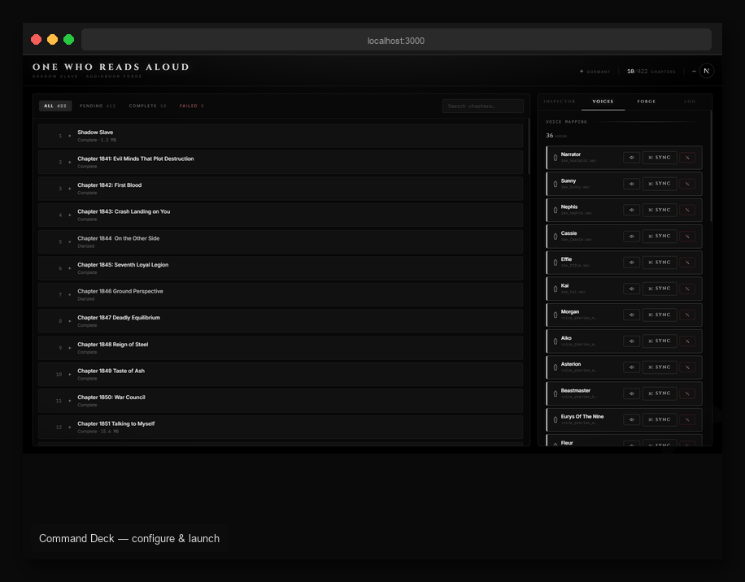
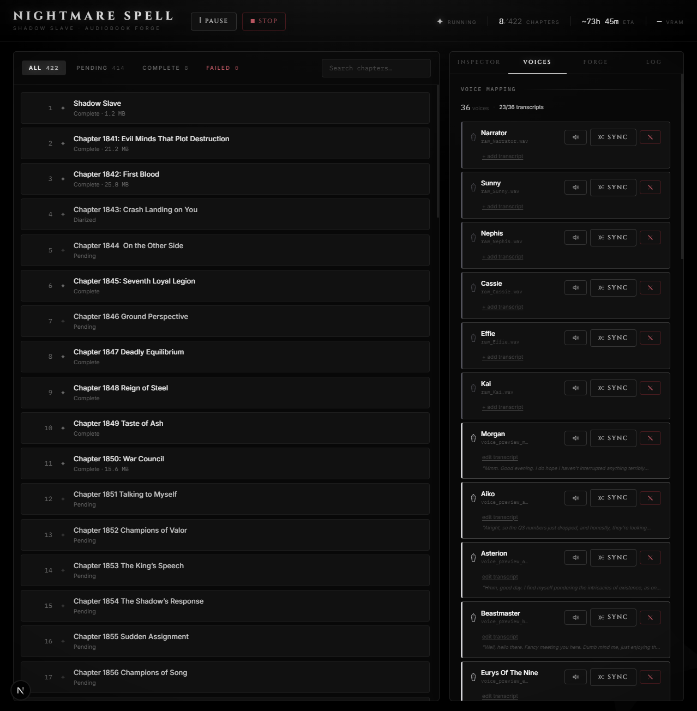
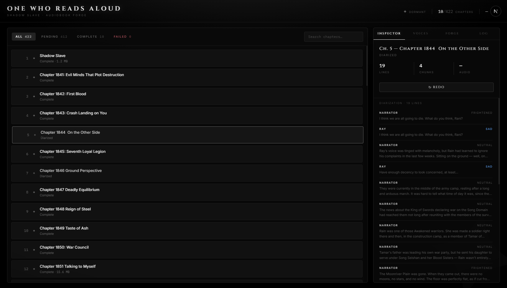

<h1 align="center">One Who Reads Aloud</h1>

<p align="center"><i>A local, full-cast audiobook studio for <b>Shadow Slave</b>: every line attributed, every character voiced.</i></p>

<p align="center">
  <a href="https://github.com/ch4ngingstar/one-who-reads-aloud-v2/actions/workflows/ci.yml"></a>
  <a href="https://github.com/ch4ngingstar/one-who-reads-aloud-v2/releases/latest"></a>
  
  
  
  
</p>

<p align="center">
  <b><a href="https://github.com/ch4ngingstar/one-who-reads-aloud-v2/releases/download/demo-audio/the-bridge-in-the-fog.mp3">▶ Listen to the demo</a></b> <sub>(an original scene, 8 voices, 2:19)</sub>
  &nbsp;·&nbsp; <a href="#quick-start">Quick start</a>
  &nbsp;·&nbsp; <a href="#how-it-works">How it works</a>
  &nbsp;·&nbsp; <a href="#measured-not-claimed">Accuracy</a>
  &nbsp;·&nbsp; <a href="CHANGELOG.md">Changelog</a>
</p>

> [!NOTE]
> **Unofficial fan project.** *Shadow Slave* is the work of Guiltythree. This repository ships code and configuration only: no novel text, no book audio, no model weights. Bring your own EPUB.

> [!IMPORTANT]
> **Everything runs on your machine.** Labelling, voices and mixing need one NVIDIA GPU with 12 GB of VRAM and no API keys. Nothing you import leaves your computer.

---

**One Who Reads Aloud** is a local, full-cast audiobook studio built for the *Shadow Slave* web novel. It imports an EPUB, works out who speaks each line and how, routes every character to a voice chosen by blind listening tests, checks the recorded takes with Whisper, and exports chapter MP3s or chaptered M4B volumes. It runs on one NVIDIA GPU with 12 GB of VRAM, with no API keys and no cloud processing.

> The hard part of a full-cast audiobook is not the voices; it is knowing *who is speaking*. This project measures that, and shows you the lines it is unsure about.

## Highlights

- 🎭 **A real cast** — The narrator and Sunny, Cassie, Anvil and Seishan are recorded with OmniVoice; every other character with Fish S2 Pro. Each casting choice won a blind listening test. Speakers without a voice of their own get a stand-in of the right gender, never the narrator.
- 🔍 **Attribution with review** — A local Qwen3-14B labels every quote in two independent passes; Gemma 3, a different model family, checks it. On held-out chapters, lines where all three agree were **98.4%** right, and **16.7%** of lines were flagged for review (9.7% across 80 real chapters).
- 📖 **The whole text** — Chapters are read straight from the EPUB, recovering paragraphs an older parser had dropped. «Guillemets», mixed quote marks and unclosed quotes are understood, and site watermarks ("novelfire.net" in small capitals) are removed before anyone reads them aloud.
- 🎚️ **Studio finish** — Whisper reads takes back and retakes clear misreads; actors are levelled to a common loudness; pauses follow paragraphs and turns of conversation; files carry real chapter numbers and titles; volumes export as M4B with chapter marks.
- 🧰 **One button** — Pick a book and a chapter range in the app and press Start. Labelling, checking, recording and mixing run in order with one model on the GPU at a time. Interrupted runs continue chapter by chapter.

<details>
<summary><b>Screenshots</b></summary>



**Live pipeline run**: chapter progress, VRAM transitions, per-line log.



**Inspector**: every line with its speaker and emotion; flagged lines first, one click to confirm or recast.



</details>

## Measured, not claimed

Accuracy is measured against hand-checked answer keys. Each chapter was labelled independently by two annotators who agreed on 99.7% and 100% of speakers; the few disagreements were settled by reading the text. The **held-out** chapters were never used while tuning the system.

| Speaker attribution | Held-out (7 ch, 294 quotes) | Development (8 ch, 314 quotes) |
| --- | ---: | ---: |
| Previous labeller, 50-line spot check | ~60% | — |
| Qwen alone, fully automatic | 94.6% | 96.5% |
| **Lines where Qwen's two blind votes and Gemma agree** | **98.4%** | **99.6%** |
| Lines flagged for review | 16.7% | 9.6% |
| After the flagged lines are checked by hand | 98.6% | 99.7% |

The 50-line spot check is a different, smaller sample and is shown only for scale. On 80 unlabelled chapters of volume 8 the review flag rate was 9.7%.

**Emotion** is scored against the same keys: 92–97% of lines receive an emotion the annotators listed as acceptable. The four emotions that change a recording (whispering, laughing, coldness, command) are used only when the narration says so ("she whispered", "he chuckled").

`scripts/label_eval.py` computes every number above. The answer keys contain the novel's text, so they stay on the author's machine; the script and its format are here to build your own.

### A line's journey

An invented passage, traced through the system:

> Rain stared at the dark cottage. Her teacher sighed.
>
> "Come inside."

| Step | Result |
| --- | --- |
| Evidence | The action before the quote belongs to *her teacher*, which in Rain's chapters means **Sunny** (268 of 278 uses in volumes 8–11). |
| Candidates | Sunny, Rain, Ray, someone unnamed |
| Qwen, pass 1 / pass 2 (options reversed) | Sunny / Sunny |
| Gemma, blind | Sunny |
| Verdict | Sunny, not flagged; recorded with Sunny's OmniVoice reference, neutral delivery |

Had any vote differed, the line would carry *"Speaker unsure: …"* in the Inspector with a one-click **✓ Sunny is right** or a speaker menu.

## How it works

```mermaid
flowchart LR
    A[EPUB] --> B[Clean text<br/>restore · scrub · split quotes]
    B --> C[Evidence<br/>tags · he/she · beats · who's present]
    C --> D[Qwen3-14B<br/>two blind votes]
    D -->|votes split| E[Qwen reasons]
    D --> F[Gemma 3<br/>blind second opinion]
    E --> F
    F --> G[Script + review flags]
    G --> H[Score: voice, emotion, pacing]
    H --> I[OmniVoice · Fish S2 Pro]
    I --> J[Whisper read-back]
    J -->|misread| I
    J --> K[Level, mix, tag]
    K --> L[Chapter MP3 · volume M4B]
```



1. **Clean text.** Chapters come from the EPUB with every paragraph intact. A position-based quote scanner handles « », '…" and quotes that run to the paragraph end, and flags the ones it cannot settle.
2. **Evidence.** Rules read each quote the way a careful reader does: "X said", "*she* said:" (and who *she* is), the action just before the line ("Morgan laughed."), names used to address someone, who is in the scene, unnamed people ("Ling's dad", "one of the porters"), and characters known by description ("her teacher" is Sunny in Rain's chapters). Genders, aliases and epithets live in [`profiles/characters.json`](profiles/characters.json).
3. **Two votes, one second opinion.** Qwen chooses from a short candidate list twice, the second time without seeing the first answer and with the options reversed. Gemma votes without seeing either. Each model loads once per batch and reads the chapter from a prefix cache, so each question costs only a few hundred tokens.
4. **Record.** Each line becomes a cue: who, how, which engine, which reference clip. OmniVoice and Fish S2 Pro record their parts in separate passes; Whisper transcribes every take and retakes misreads.
5. **Mix.** Actors are levelled, pauses follow the text's shape, and the chapter is exported with ID3 tags and a timed script. Change one line's speaker in the Inspector and only that line is re-recorded.

## Quick start

**You need:** Windows 10/11, an NVIDIA GPU with 12 GB VRAM, Python 3.11, Node 18+, FFmpeg on `PATH`, about 30 GB of disk for models.

```powershell
git clone https://github.com/ch4ngingstar/one-who-reads-aloud-v2.git
cd one-who-reads-aloud-v2
pip install -r requirements.txt
pip install llama-cpp-python --extra-index-url https://abetlen.github.io/llama-cpp-python/whl/cu124 --no-cache-dir
cd ui; npm install; cd ..
```

**Models** (all local, all downloaded once):

```powershell
# Labeller and second opinion
hf download Qwen/Qwen3-14B-GGUF Qwen3-14B-Q4_K_M.gguf --local-dir models
hf download bartowski/google_gemma-3-12b-it-GGUF google_gemma-3-12b-it-Q4_K_M.gguf --local-dir models

# Character voices: Fish S2 Pro (Q8_0 GGUF) served by audio.cpp
hf download audio-cpp/audio.cpp-gguf Fish-Audio-S2-Pro-GGUF/fish-audio-s2-pro-q8_0.gguf --local-dir models/audio-cpp
#   then unpack the audio.cpp v0.9.4 Windows Vulkan build into models/audio-runtime/

# Narration: OmniVoice in its own environment
.\scripts\setup_omnivoice.ps1
```

**Run:**

```powershell
.\start.bat
```

The launcher starts the backend and the UI and opens the studio. In **Forge**, choose an EPUB (any folder; a copy is kept in `data/input/`) and a chapter range, then press **Start**. Upload or audition voices in **Voices**. Review flagged lines in **Inspector → Needs review**. Export a volume as M4B from the chapter list.

<details>
<summary><b>Command-line tools</b></summary>

| Command | What it does |
| --- | --- |
| `python scripts/label_book.py --from 1841 --to 1860` | Label, double-check and store a chapter range outside the app (resumable). |
| `python scripts/label_eval.py score data/labels/<run>` | Score a labelling run against the answer keys. |
| `python scripts/cast.py discover \| screen \| apply` | Find characters who need voices, screen designed candidates, apply blind-vote picks. |
| `python scripts/export_m4b.py` | Build an M4B audiobook with chapter marks. |
| `python scripts/benchmark_chapter.py <chapter id>` | Time one chapter end to end on a copy of the database. |
| `python scripts/check_readback.py <chapter id>` | Compare a finished MP3 against its script. |

</details>

<details>
<summary><b>Optional: IndexTTS 2.5 as an alternative renderer</b></summary>

IndexTTS 2.5 remains available as a single-engine edition with separate timbre and emotion controls. Install it into `models/indextts25-runtime` and select it under **Forge → Speech renderer**.

```powershell
git clone https://github.com/index-tts/index-tts.git models/indextts25-runtime
git -C models/indextts25-runtime checkout d9e41aac89fd00b3d71497fddb287b7f24613712
uv sync --project models/indextts25-runtime --python 3.11 --frozen
hf download IndexTeam/IndexTTS-2.5 --revision c39ce5ba981572cb187443877ff559dfb246ce63 --local-dir models/indextts25-runtime/checkpoints --exclude "qwen*"
```

</details>

## Performance

Measured on an RTX 4070 (12 GB), Windows 11.

| Stage | Cost |
| --- | --- |
| Labelling + second opinion | 15–40 s per chapter (batches of 20 average about 16 s) |
| Fish S2 Pro character lines | about 30 s to load, then about 2 s per line; peak 9.4–10.9 GB |
| Peak VRAM | one model at a time, kept under 12 GB; the pipeline waits for memory to clear between stages |

## Limitations

- **Built for one series.** Rules, aliases and the cast are tuned to *Shadow Slave*. Another book needs its own [`profiles/characters.json`](profiles/characters.json) and voices; the pipeline itself is book-agnostic.
- **English only.** The quote scanner and attribution rules assume English typography and grammar.
- **Review is part of the design.** About 1 quote in 10 is flagged. Unflagged lines are still about 1.6% wrong on held-out chapters.
- **Read-back is a safety net, not a proof.** Whisper catches misread words; it cannot hear a wrong actor or an odd inflection.
- **Source text quality.** Scraped EPUBs carry typos and occasional corrupted passages; those lines are labelled as written.
- **Windows first.** The launchers are PowerShell and the Fish runtime is a Windows Vulkan build; the Python backend itself is portable.

## Project layout

```
src/
  epub_parser.py · book_text.py · text_cleanup.py · segmenter.py   text in, repaired and split
  character_bible.py · attribution_evidence.py                     who could be speaking, and why
  qwen_labeller.py · label_pipeline.py · label_director.py         votes, second opinion, storage
  performance_score.py · recording_room.py · fish_provider.py      cues and recording engines
  audio_assembler.py · cast_mix.py · pacing.py · book_export.py    mix, pacing, MP3 and M4B
  orchestrator.py · api.py · state_manager.py                      pipeline, HTTP API, SQLite state
ui/            Next.js studio: Forge, Voices, Inspector, Sound, Command Deck
profiles/      cast routing, character sheet, delivery cues, voice briefs
scripts/       labelling, casting, evaluation and export tools
tests/         347 Python tests; ui/tests holds 54 more. No GPU needed.
```

## Tests

```powershell
pytest                                  # backend: models and synthesis are stubbed
cd ui; npm test; npm run typecheck      # studio
```

## Contributing

Issues and pull requests are welcome; see [CONTRIBUTING.md](CONTRIBUTING.md). Please never attach novel text, book audio or model weights.

## Credits

Built on open models and tools: [Qwen3](https://huggingface.co/Qwen/Qwen3-14B-GGUF) (labelling), [Gemma 3](https://huggingface.co/google/gemma-3-12b-it) (second opinion), [OmniVoice](https://huggingface.co/k2-fsa/OmniVoice) and [Fish Audio S2 Pro](https://huggingface.co/fishaudio/s2-pro) (voices), [audio.cpp](https://huggingface.co/audio-cpp/audio.cpp-gguf) (Fish runtime), [IndexTTS](https://github.com/index-tts/index-tts), [faster-whisper](https://github.com/SYSTRAN/faster-whisper) (read-back), [llama.cpp](https://github.com/ggml-org/llama.cpp), FFmpeg. Model weights keep their own licences; check them before any use beyond personal listening.

## A note on the content

This repository holds code and configuration only: no novel text, no audio of the book and no model weights. The demo on the release page is an original scene written for this project. You supply your own EPUB and voice clips. *Shadow Slave* is the work of Guiltythree. Read it on [Webnovel](https://www.webnovel.com/book/shadow-slave_21880912006091605) and support the author.

## License

[MIT](LICENSE) for the code.
